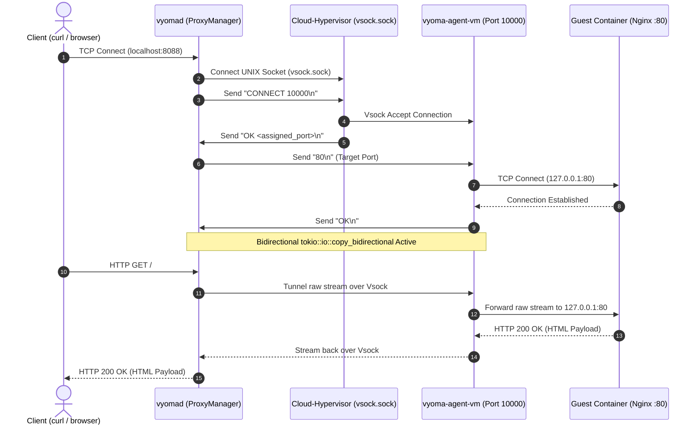

# ADR-045: Rootless MicroVM Networking via Vsock L4 Stream Forwarding

- **Status**: Accepted
- **Date**: 2026-10-25
- **Deciders**: Vyoma Architecture Team
- **Context**: Rootless MicroVM Developer Experience & Host Isolation

---

## 1. Context & Problem Statement

Modern microVM virtualization engines (such as Cloud-Hypervisor, Firecracker, and QEMU) traditionally rely on Linux TAP devices (`tun/tap`), kernel software bridges (`bridge`), and netfilter rules (`iptables` / `nftables` MASQUERADE) to connect guest virtual machines to host networks and map published container ports (e.g. `-p 8088:80`).

However, this traditional architecture creates a fundamental privilege paradox for modern developer tools:
1. **Host Privilege Requirements**: Creating TAP interfaces (`ip tuntap add mode tap`), managing network namespaces (`ip netns add`), and manipulating netfilter rules require either absolute `root` privileges (`sudo`) or `CAP_NET_ADMIN` capabilities on the host kernel.
2. **Operational Friction**: In modern development environments (developer laptops without sudo access, CI/CD runners like GitHub Actions, and locked-down Kubernetes pods), unprivileged users cannot execute `sudo`. When running `vyoma run nginx:alpine -p 8088:80` in user mode, the Linux kernel rejected interface creation with:
   ```text
   ioctl(TUNSETIFF): Operation not permitted
   ```
3. **Guest Boot Hangs**: Because the host TAP device could not be provisioned, the hypervisor launched the VM with `net: None`. The guest init script hung in a blocking loop waiting for `eth0` to appear, preventing container startup.
4. **Host Network Pollution**: Traditional bridge/TAP networking litters the host kernel with ghost network devices and leftover iptables rules whenever VMs exit or terminate unexpectedly.

To establish Vyoma as the next-generation microVM container runtime, **Vyoma must provide zero-friction, 100% rootless container networking out of the box with zero sudo requirements.**

---

## 2. Decision

We have decided to implement **Solution 2: Vsock-based L4 Port Forwarding** as Vyoma's primary rootless networking architecture.

### Key Architectural Pillars:

1. **Host-Side Vsock Unix Socket**:
   - Cloud-Hypervisor is configured with `--vsock cid=<CID>,socket=<vm_dir>/vsock.sock`.
   - On Linux, Unix Domain Sockets require standard user-level filesystem permissions with **zero root capabilities**.
   - Host `ProxyManager` (`crates/vyoma-core/src/proxy.rs`) binds unprivileged host TCP ports (e.g. `0.0.0.0:8088`) in userspace.

2. **In-VM Guest Agent (`vyoma-agent-vm`)**:
   - Injected statically via initramfs (`x86_64-unknown-linux-musl`), running as a daemon inside the guest microVM.
   - Listens on `AF_VSOCK` at `VMADDR_CID_ANY` on two dedicated vsock ports:
     - **Port 10000 (L4 Port Forwarding Multiplexer)**: Accepts connections from the host proxy, reads the target container port (e.g. `80\n`), connects to `127.0.0.1:<target_port>`, and bridges traffic bidirectionally.
     - **Port 9999 (In-VM Introspection Protocol)**: Serves length-prefixed JSON requests (`GetMetrics`, `ProcessList`, `FileRead`, `ExecCommand`) over vsock with zero IP network dependency.

3. **Cloud-Hypervisor Handshake & L4 Splicing Protocol**:
   - When a host client connects to `0.0.0.0:host_port`:
     1. Host proxy connects to `<vm_dir>/vsock.sock`.
     2. Host sends Cloud-Hypervisor control command: `CONNECT 10000\n`.
     3. Cloud-Hypervisor connects to guest vsock port 10000 and responds: `OK <assigned_host_port>\n`.
     4. Host proxy sends target port: `<vm_port>\n` (e.g. `80\n`).
     5. Guest agent verifies target service is listening on `127.0.0.1:<vm_port>` (with an active retry loop of up to 1.5s to account for container initialization delays) and responds: `OK\n`.
     6. Host proxy and guest agent splice streams using asynchronous zero-copy `tokio::io::copy_bidirectional`.

4. **Non-Blocking Guest Init Script**:
   - The `/sbin/vyoma-init` script inside initramfs configures `eth0` only if a physical virtio-net interface is detected, preventing blocking hangs when running in rootless mode.
   - Loopback `lo` is always brought up immediately (`ip link set lo up`), ensuring container processes binding to `0.0.0.0` or `127.0.0.1` are instantly accessible.

5. **Deprecation and Cleanup**:
   - Removed obsolete, unintegrated slirp code (`crates/vyoma-core/src/slirp.rs`).
   - Cleaned up noisy failure warnings in unprivileged environments.

---

## 3. Communication Sequence Diagram



---

## 4. Consequences & Benefits

### Positive
- **Zero Sudo Required**: Developers can run `vyoma run nginx:alpine -p 8088:80` out of the box on any Linux machine with `/dev/kvm` access without needing root passwords.
- **Microsecond Latency**: Vsock traffic traverses shared-memory virtio ring buffers between host and guest kernel, completely bypassing Ethernet framing, ARP resolution, and host iptables packet inspection.
- **Zero Host Network Pollution**: Terminating a microVM leaves zero orphan TAP interfaces, bridge interfaces, or stale firewall rules on the host.
- **Multi-Port Dynamic Multiplexing**: The in-VM agent dynamically connects to any requested container port on demand through a single vsock channel without requiring hardcoded port lists in the VM kernel boot parameters.
- **Production CI/CD Compatibility**: Vyoma can run seamlessly inside rootless Docker containers, GitHub Actions self-hosted runners, and Kubernetes worker nodes without requiring privileged security contexts.

### Negative / Trade-offs
- MicroVM does not obtain a distinct host-routable MAC/IP address on the physical LAN (only mapped ports are published to host interfaces). For transparent LAN bridging, privileged TAP mode remains available as an optional backend.
