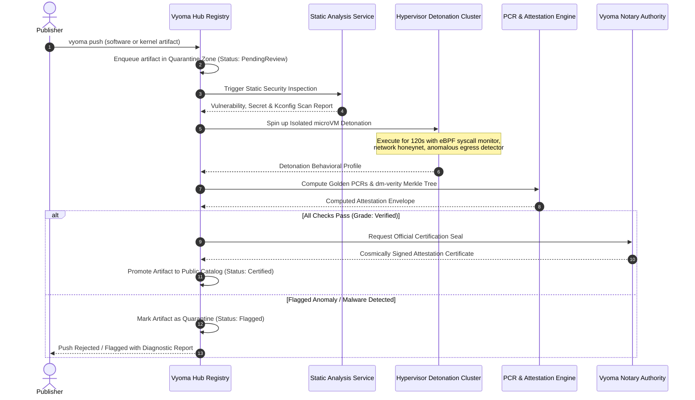
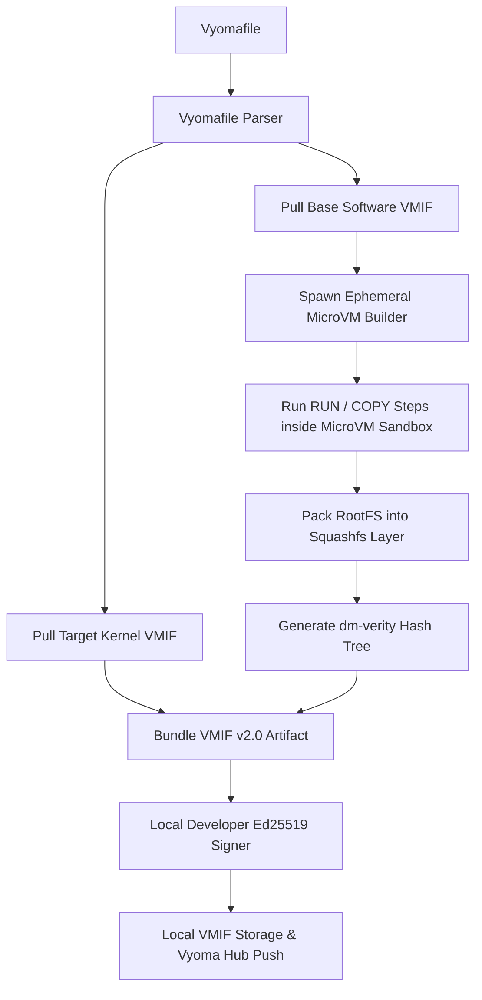
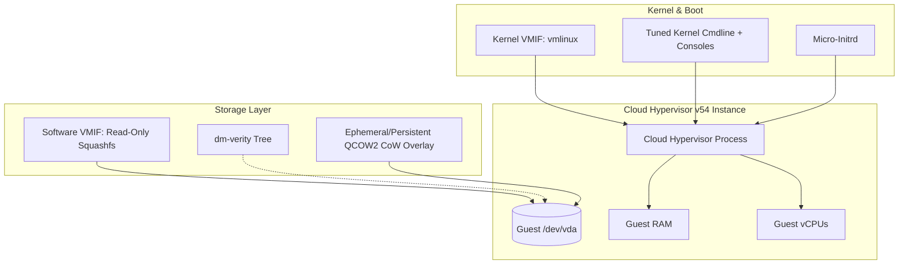

# Vyoma VMIF v2.0 & Vyoma Hub Trust Architecture Specification

**Status**: Approved Architecture Blueprint  
**Authors**: Vyoma Core Architecture Team  
**Scope**: VMIF 2.0 Format, Cryptographic Supply Chain, Pre-Hub Strategy, Migration Roadmap, and Hub Verification Engine  

---

## 1. Executive Summary & The MicroVM Paradigm Shift

### 1.1 Why OCI Fails MicroVMs
The Open Container Initiative (OCI) image specification was designed for OS-level virtualization (Linux namespaces and cgroups sharing a single host kernel). Containers do not carry a kernel, cannot attest to hardware integrity, and assume direct host-kernel syscall pass-through.

When running microVMs (via Cloud Hypervisor, Firecracker, or QEMU), each workload executes within an isolated hardware virtualization boundary with its own guest kernel, virtual firmware, virtual devices, and cryptographic measurement registers (TPM PCRs, AMD SEV-SNP, Intel TDX).

| Dimension | Docker / OCI Standard | Vyoma VMIF v2.0 |
| :--- | :--- | :--- |
| **Virtualization Primitive** | Shared host kernel namespaces & cgroups | Hardware-isolated microVM boundary |
| **Kernel Coupling** | None (host kernel dependent) | First-class, versioned, workload-tuned guest kernels |
| **Storage Architecture** | Tarball layer stacks (OverlayFS) | Block-level Squashfs / dm-verity + QCOW2 CoW overlay |
| **Hardware Attestation** | None | Root-of-Trust measured boot (PCR0–PCR9, SEV-SNP, TDX) |
| **Trust Model** | Unverified registry push (vulnerable to malware) | App Store-style automated detonation & certification gate |
| **Boot Latency** | Instant container fork | Sub-15ms direct kernel microVM boot |

### 1.2 The Vision: An "App Store" for MicroVM Artifacts
Vyoma Hub is modeled after **Google Play Store / Apple App Store**, moving beyond simple static blob registries (like Docker Hub). Every artifact pushed to Vyoma Hub—whether an **Application Software RootFS** (e.g., PostgreSQL, Node.js, Nginx) or a **Specialized Kernel** (e.g., Database-tuned, Edge-networking, Confidential SEV-SNP)—must pass a rigorous automated multi-tier verification pipeline before receiving a cryptographic certification seal.

```mermaid
flowchart LR
    Dev([Developer / Vendor]) -->|Push Artifact| HubIngest[Vyoma Hub Ingest]
    subgraph Vyoma Hub Verification Pipeline
        HubIngest --> StaticScan[1. Static Security & CVE Scan]
        StaticScan --> Detonation[2. Dynamic Sandboxed Detonation]
        Detonation --> KernelAudit[3. Kernel Integrity & Kconfig Audit]
        KernelAudit --> MeasuredBoot[4. Golden PCR & Attestation Precomputation]
        MeasuredBoot --> CertSign[5. Vyoma Hub Trust Authority Signature]
    end
    CertSign --> HubCatalog[(Vyoma Hub Store)]
    HubCatalog -->|vyoma pull / run| VyomaDaemon[vyomad Runtime Engine]
    VyomaDaemon -->|Verify Seal & Policy| MicroVM[Cloud Hypervisor microVM]
```



---

## 2. In-Depth Cryptographic & Attestation Audit

A thorough audit of the existing codebase ([`crates/vyoma-image/src/signing.rs`](file:///home/subesh/Startup_Projects/Vyoma/vyoma/crates/vyoma-image/src/signing.rs), [`crates/vyoma-core/src/attest.rs`](file:///home/subesh/Startup_Projects/Vyoma/vyoma/crates/vyoma-core/src/attest.rs), and [`crates/vyoma-core/src/unified_attest.rs`](file:///home/subesh/Startup_Projects/Vyoma/vyoma/crates/vyoma-core/src/unified_attest.rs)) reveals both strong foundations and critical gaps that must be modernized for VMIF v2.0.

### 2.1 What Works Well (Keep and Retain)
1. **Asymmetric Algorithm Choice (Ed25519)**:
   - `ed25519-dalek` provides high performance, constant-time operations, and resistance to side-channel attacks, avoiding the complexity and pitfalls of legacy RSA or unpadded ECDSA.
2. **Clean Attestation Modeling**:
   - `TpmQuote`, `SnpAttestationReport`, and `TdxAttestationReport` cleanly capture the hardware attestation structures from vTPM 2.0, AMD SEV-SNP, and Intel TDX.
3. **`UnifiedAttestationManager` Abstraction**:
   - Gathers heterogeneous measurement results into a standardized response (`MeasurementResult` vector with PCR names and boolean verification statuses).

### 2.2 Critical Gaps & Technical Debt (What to Fix & Replace)
1. **Non-Canonical JSON Serialization (JCS Vulnerability)**:
   - *Current Implementation*: `serde_json::to_vec(&manifest)` is used directly before signing.
   - *Flaw*: Key order, whitespace, and floating-point representations in `serde_json` are non-deterministic across different platforms, compilers, and parsers. This causes valid signatures to fail or opens canonicalization attack vectors.
   - *Fix*: Adopt **RFC 8785 (JSON Canonicalization Scheme - JCS)** via a deterministic serializer before signing and verifying.
2. **Missing PKI & Trust Hierarchy (Raw Keys vs Notary Hierarchy)**:
   - *Current Implementation*: `TrustPolicy` only compares raw 32-byte public keys stored in a flat directory (`~/.vyoma/trusted_keys/`).
   - *Flaw*: No key expiration, no role separation (Root of Trust vs Release Key vs Developer Key), and no revocation mechanism.
   - *Fix*: Implement a 3-tier trust hierarchy modeled after TUF (The Update Framework):
     - **Root Key**: Hardcoded/pinned root trust anchor.
     - **Hub Notary Authority**: Issues short-lived image verification certificates.
     - **Publisher Key**: Identity of the organization or developer.
3. **Incomplete TPM Quote & SEV-SNP Signature Verification**:
   - *Current Implementation*: In `crates/vyoma-core/src/attest.rs`, `verify_quote` and `verify_snp_report` compare PCR hashes against `expected_pcrs`, but only check `if report.signature.is_empty()`.
   - *Flaw*: It does not mathematically verify the cryptographic signature of the TPM quote using the vTPM Attestation Identity Key (AIK), nor does it verify the SEV-SNP ECDSA P-384 signature against the AMD VCEK certificate chain.
   - *Fix*: Implement real cryptographic quote signature verification against the virtual hypervisor's AIK public key and AMD VCEK certificates.
4. **Missing dm-verity Merkle Tree Root Hash Binding**:
   - The Squashfs rootfs needs its Merkle tree root hash signed directly within the manifest, allowing the guest kernel to mount the rootfs with dm-verity enabled (`roothash=...`), preventing any runtime block tampering.

---

## 3. VMIF v2.0 Technical Specification

### 3.1 Artifact Taxonomy & Media Types

```text
application/vnd.vyoma.image.index.v2+json          (Multi-arch index)
application/vnd.vyoma.image.manifest.v2+json       (Top-level VMIF manifest)
application/vnd.vyoma.image.software.v2+json       (Software rootfs manifest)
application/vnd.vyoma.image.kernel.v2+json         (Kernel manifest)
application/vnd.vyoma.image.composite.v2+json      (Composite bundled manifest)
application/vnd.vyoma.image.verification.v2+json   (App Store certification report)
application/vnd.vyoma.layer.rootfs.squashfs        (Root filesystem layer)
application/vnd.vyoma.layer.rootfs.verity          (dm-verity hash tree layer)
application/vnd.vyoma.layer.kernel.vmlinux         (Raw or stripped vmlinux binary)
application/vnd.vyoma.layer.kernel.initrd          (Minimal ramdisk)
```

### 3.2 Manifest Schemas

#### A. Kernel VMIF Manifest (`vmif-kernel.json`)
```json
{
  "schemaVersion": 2,
  "mediaType": "application/vnd.vyoma.image.kernel.v2+json",
  "created": "2026-11-21T12:00:00Z",
  "artifactType": "kernel",
  "architecture": "x86_64",
  "metadata": {
    "name": "vyoma/kernel-db",
    "version": "6.16.9-vyoma-db-v1",
    "workload": "database",
    "description": "I/O intensive database kernel with deadline scheduler, io_uring, and transparent hugepages enabled"
  },
  "kernel": {
    "mediaType": "application/vnd.vyoma.layer.kernel.vmlinux",
    "digest": "sha256:4a8b79e18b871c5ef91b920e4b8593671234abcd5678ef0123456789abcdef01",
    "size": 14680064,
    "format": "elf64",
    "compression": "none",
    "pvhBoot": true
  },
  "initrd": {
    "mediaType": "application/vnd.vyoma.layer.kernel.initrd",
    "digest": "sha256:91b2c3d4e5f6a7b8c9d0e1f2a3b4c5d6e7f8a9b0c1d2e3f4a5b6c7d8e9f0a1b2",
    "size": 2457600
  },
  "configuration": {
    "recommendedCmdline": [
      "console=hvc0",
      "root=/dev/vda",
      "rw",
      "elevator=deadline",
      "transparent_hugepage=always",
      "noswap",
      "iomem=relaxed"
    ],
    "sysctlDefaults": {
      "vm.dirty_ratio": "15",
      "vm.dirty_background_ratio": "5",
      "vm.overcommit_memory": "2"
    },
    "features": ["io_uring", "hugepages", "direct_io", "zero_swap"],
    "minimumHardware": {
      "vcpus": 2,
      "memoryMib": 1024
    }
  },
  "security": {
    "goldenPcrs": {
      "0": "a1b2c3d4e5f60718293a4b5c6d7e8f90123456789abcdef0123456789abcdef0",
      "1": "0000000000000000000000000000000000000000000000000000000000000000",
      "2": "f0e1d2c3b4a5968778695a4b3c2d1e0f0123456789abcdef0123456789abcdef"
    },
    "confidentialComputing": {
      "sevSnpSupported": true,
      "tdxSupported": true,
      "sevSnpExpectedMeasurement": "e3b0c44298fc1c149afbf4c8996fb92427ae41e4649b934ca495991b7852b855"
    }
  }
}
```

#### B. Software VMIF Manifest (`vmif-software.json`)
```json
{
  "schemaVersion": 2,
  "mediaType": "application/vnd.vyoma.image.software.v2+json",
  "created": "2026-11-21T12:00:00Z",
  "artifactType": "software",
  "architecture": "x86_64",
  "metadata": {
    "name": "vyoma/postgres",
    "version": "16.4-alpine",
    "compatibleWorkloads": ["database"]
  },
  "rootfs": {
    "mediaType": "application/vnd.vyoma.layer.rootfs.squashfs",
    "digest": "sha256:77f1981cb31e50f58d927c945a0db8316c02eb92965313936a71bbd792e34567",
    "size": 184549376,
    "compression": "zstd",
    "verity": {
      "mediaType": "application/vnd.vyoma.layer.rootfs.verity",
      "rootHash": "3f2504e0ad3017cf65b83592c73087fac60b07118460c1ecd677180cfb1d2345",
      "algorithm": "sha256",
      "blockSize": 4096
    }
  },
  "execution": {
    "entrypoint": ["docker-entrypoint.sh"],
    "cmd": ["postgres"],
    "workdir": "/var/lib/postgresql",
    "env": {
      "PGDATA": "/var/lib/postgresql/data",
      "PATH": "/usr/local/sbin:/usr/local/bin:/usr/sbin:/usr/bin:/sbin:/bin"
    },
    "ports": [
      { "guestPort": 5432, "protocol": "tcp" }
    ],
    "volumes": [
      { "guestPath": "/var/lib/postgresql/data", "mode": "rw" }
    ]
  },
  "suggestedKernel": "vyomahub.io/kernels/db:6.16"
}
```

#### C. Composite VMIF Manifest (`vmif-composite.json`)
```json
{
  "schemaVersion": 2,
  "mediaType": "application/vnd.vyoma.image.composite.v2+json",
  "created": "2026-11-21T12:05:00Z",
  "artifactType": "composite",
  "metadata": {
    "name": "myorg/custom-postgres",
    "version": "1.0.0"
  },
  "components": {
    "kernel": {
      "ref": "vyomahub.io/kernels/db:6.16",
      "digest": "sha256:4a8b79e18b871c5ef91b920e4b8593671234abcd5678ef0123456789abcdef01"
    },
    "software": {
      "ref": "vyomahub.io/library/postgres:16",
      "digest": "sha256:77f1981cb31e50f58d927c945a0db8316c02eb92965313936a71bbd792e34567"
    }
  },
  "runtimeOverrides": {
    "cmdlineExtra": ["max_connections=200"],
    "envOverrides": {
      "POSTGRES_DB": "production"
    }
  }
}
```

---

## 4. The Pre-Hub Era: Managing Without Vyoma Hub Today

Because the multi-tenant Vyoma Hub SaaS is not yet deployed, the system functions autonomously, securely, and seamlessly today without requiring an external centralized service.

```mermaid
flowchart TD
    subgraph Pre-Hub Local Topology
        DockerHub[Docker Hub / GHCR] -->|1. Pull Container Image| HubBridge[Local HubBridge]
        HubBridge -->|2. Convert to Squashfs| LocalVMIF[(Local VMIF Store)]
        
        KCatalog[Embedded KernelCatalog] -->|3. Match Workload Profile| KStore[/var/lib/vyoma/kernels]
        KStore --> LocalVMIF
        
        DevKeys[~/.vyoma/keys/developer.key] -->|4. Local Ed25519 Sign| LocalVMIF
        
        StaticCDN[GitHub Releases / R2] -.->|Fallback Download Signed Kernels| KStore
    end
    
    LocalVMIF -->|5. vyoma run| VyomaDaemon[vyomad]
    VyomaDaemon --> MicroVM[Cloud Hypervisor microVM]
```

### 4.1 Local Autonomous Operations

1. **Direct Docker Hub & OCI Ingestion via `HubBridge`**:
   - When a user runs `vyoma run postgres:16` or `vyoma run nginx:alpine`:
     - `HubBridge` pulls the OCI image directly from Docker Hub or GitHub Container Registry (GHCR).
     - It unpacks layers in userspace and generates a local read-only `rootfs.sqfs` image.
     - It generates a local `vmif-software.json` metadata manifest.
2. **Local Workload Kernel Auto-Matching**:
   - The embedded [`KernelCatalog`](file:///home/subesh/Startup_Projects/Vyoma/vyoma/crates/vyoma-image/src/kernel_catalog.rs) analyzes the image name or metadata (e.g. `postgres` $\to$ `vyoma/kernel-db`, `nginx` $\to$ `vyoma/kernel-edge`).
   - If a specialized kernel is not available locally, it pairs the software layer with the universal PVH kernel bundled at `/var/lib/vyoma/bin/vmlinux`.
3. **Local Developer Keyring & Self-Signing (`vyoma keygen`)**:
   - Developers and organizations generate local Ed25519 keypairs stored in `~/.vyoma/keys/developer.key`.
   - Manifests built via `vyoma build` are signed locally.
   - Public keys placed in `~/.vyoma/trusted_keys/` or `/etc/vyoma/trusted_keys/` are trusted automatically by `vyomad`.
4. **Local Static Security Scanning**:
   - In place of the cloud detonation cluster, `vyoma build` and `vyomad` run local static scans (verifying package checksums, scanning for cleartext credentials, and checking ELF binary capabilities).
5. **Static Remote Kernel Fallback (GitHub Releases / S3)**:
   - Official kernel binaries (`kernel-db.vmlinux`, `kernel-edge.vmlinux`, `kernel-ai.vmlinux`) are hosted as static release assets on GitHub Releases (`https://github.com/VyomaVM/kernels/releases/download/...`).
   - `vyomad` automatically downloads missing kernels upon first request, verifying their hardcoded SHA-256 digests and Ed25519 signatures.

---

## 5. Migration Strategy: Transitioning to the Full Vyoma Hub

The transition from the Pre-Hub phase to the full Vyoma Hub Cloud Registry is designed to be 100% backward-compatible, requiring zero breaking changes for existing users.

```mermaid
flowchart LR
    subgraph Phase 0: Pre-Hub Now
        P0_OCI[Docker Hub / OCI] --> P0_Bridge[Local HubBridge] --> P0_Cache[(Local Cache)]
    end
    
    subgraph Phase 1: Hybrid Registry
        P1_Harbor[Self-Hosted Harbor / ECR] --> P1_OCIProto[OCI Artifact Protocol] --> P1_Daemon[vyomad]
    end
    
    subgraph Phase 2: Full Vyoma Hub SaaS
        P2_Hub[hub.vyomavm.io] --> P2_Pipeline[5-Gate Detonation Pipeline] --> P2_Store[(Vyoma Hub Store)]
        P2_Store --> P2_Client[vyoma CLI]
    end
    
    Phase 0 --> Phase 1 --> Phase 2
```

### 5.1 Three-Stage Migration Roadmap

| Stage | Infrastructure | Resolution Flow | Trust & Verification |
| :--- | :--- | :--- | :--- |
| **Phase 0: Pre-Hub (Current)** | Local host + Docker Hub + GitHub Releases | Docker Hub OCI $\to$ Local Squashfs conversion; bundled kernels | Local Ed25519 directory + pinned SHA-256 sums |
| **Phase 1: Hybrid OCI** | Any OCI v2 Registry (Harbor, AWS ECR, GHCR) | Native VMIF artifacts stored in standard OCI registries | Cosign / Sigstore keyless signatures |
| **Phase 2: Vyoma Hub SaaS** | Distributed multi-tenant cloud (`hub.vyomavm.io`) | Unified `vyoma pull` / `vyoma run` with direct store queries | 5-Gate App Store verification, Detonation reports, Real-time CRL |

### 5.2 Zero-Downtime Cutover Mechanics
1. **Wire-Format Parity**:
   - The VMIF v2.0 manifest format developed locally is identical to the wire format stored in Vyoma Hub. Images built today will be pushable directly to Vyoma Hub on day one without rebuilding.
2. **Key Claiming & Developer Identity Migration**:
   - A developer who generated a local key in Phase 0 can claim their identity on Vyoma Hub by signing an authentication challenge with their existing private key (`vyoma hub register --claim-key ~/.vyoma/keys/developer.key`).
3. **Registry Fallback Cascade**:
   - When resolving an image, `vyomad` checks:
     1. Local cache (`~/.vyoma/images/`).
     2. Primary Vyoma Hub (`hub.vyomavm.io`).
     3. Configured third-party OCI registries.
     4. Legacy Docker Hub bridge (on-the-fly conversion).

---

## 6. Vyoma Hub 5-Gate Verification Engine (App Store Model)



1. **Gate 1: Ingestion & Provenance**: Validates publisher identity via WebAuthn/OIDC and checks in-toto supply chain metadata.
2. **Gate 2: Static Analysis**: Scans filesystem with Trivy/Grype for CVEs, runs secret-scanning regexes, and verifies kernel Kconfig flags.
3. **Gate 3: Dynamic Detonation**: Executes the image inside a sandboxed microVM equipped with eBPF probes. Detects suspicious outbound traffic, rootkit behaviors, or CPU anomalies.
4. **Gate 4: Golden PCR Calculation**: Precomputes exact SHA-256 hashes for kernel (PCR0), initrd (PCR2), and dm-verity root hash.
5. **Gate 5: Certification Seal**: Mints an Ed25519-signed verification report (`application/vnd.vyoma.image.verification.v2+json`) categorized as:
   - 🛡️ **`Certified`**: Verified publisher, 0 critical CVEs, clean detonation.
   - ⚡ **`Community`**: Clean scan, verified community build.
   - ⚠️ **`Flagged`**: Malicious behavior detected, revoked from public pulling.

---

## 7. Developer Tooling: Vyomafile & vyoma-compose

### 7.1 Enhanced `Vyomafile` Grammar & Build Workflow

```dockerfile
# Base software image (from Vyoma Hub or Docker Hub)
FROM vyomahub.io/library/postgres:16

# Workload-tuned kernel
KERNEL vyomahub.io/kernels/db-heavy:6.16

# Kernel boot arguments
KERNEL_CMDLINE transparent_hugepage=always elevator=deadline noswap

# Standard container build instructions
RUN apt-get update && apt-get install -y postgresql-16-cron
COPY init-scripts/ /docker-entrypoint-initdb.d/

# Environment and networking
ENV POSTGRES_DB=production
EXPOSE 5432

# Enforce hardware root-of-trust
VM_MEASURED_BOOT true
```



### 7.2 Enhanced `vyoma-compose.yml` Grammar

```yaml
version: "3.9"

services:
  database:
    image: vyomahub.io/library/postgres:16
    kernel: vyomahub.io/kernels/db-heavy:6.16
    volumes:
      - pgdata:/var/lib/postgresql/data
    ports:
      - "5432:5432"

  api:
    image: vyomahub.io/library/node:20-alpine
    kernel: vyomahub.io/kernels/net-edge:latest
    ports:
      - "8080:80"
    depends_on:
      database:
        condition: service_healthy

volumes:
  pgdata:
    driver: local
```

---

## 8. Runtime Architecture: Block Layer Composition

When `vyomad` boots a composite or decoupled VMIF:
1. **Software RootFS**: Attached as a read-only Squashfs block layer with dm-verity integrity.
2. **Ephemeral / Persistent Overlay**: Thin QCOW2 layer created on top of Squashfs (`qemu-img create -f qcow2 -b rootfs.sqfs overlay.qcow2`).
3. **Direct Kernel Boot**: Cloud Hypervisor receives the decoupled `vmlinux` path directly with no bios overhead.
4. **Boot Time**: **< 15 milliseconds**.



---

## 9. Implementation Roadmap & Codebase Phases

To deliver this architecture across the existing Vyoma repository, work is organized into **4 Codebase Implementation Phases**:

### Phase 1: Format & Crypto Modernization (`vyoma-image` & `vyoma-api`)
- Extend `VmifManifest` in `crates/vyoma-image/src/vmif.rs` to support explicit `Software`, `Kernel`, and `Composite` artifact types.
- Upgrade `crates/vyoma-image/src/signing.rs` to use **RFC 8785 Canonical JSON Serialization (JCS)** before signing and verification.
- Implement dm-verity Merkle tree generation and hash binding in `vyoma-storage` and `vyoma-image`.

### Phase 2: Compiler & Parser Upgrades (`vyoma-build` & `vyoma-compose`)
- Extend [crates/vyoma-build/src/parser.rs](file:///home/subesh/Startup_Projects/Vyoma/vyoma/crates/vyoma-build/src/parser.rs) to support `KERNEL`, `KERNEL_CMDLINE`, `SYSCTL`, and `VM_MEASURED_BOOT`.
- Update `vyoma build` runner to bundle the decoupled Software layer and Kernel layer into a valid VMIF v2.0 artifact.
- Extend [crates/vyoma-compose/src/schema_v3.rs](file:///home/subesh/Startup_Projects/Vyoma/vyoma/crates/vyoma-compose/src/schema_v3.rs) to support the `kernel:` field under `ServiceV3`.

### Phase 3: Pre-Hub Autonomous Bridge & Local Store (`vyoma-image` & `vyomad`)
- Upgrade [crates/vyoma-image/src/hub_bridge.rs](file:///home/subesh/Startup_Projects/Vyoma/vyoma/crates/vyoma-image/src/hub_bridge.rs) to convert Docker Hub images directly into Software VMIF format.
- Integrate the local kernel store (`/var/lib/vyoma/kernels/`) with automatic matching via `KernelCatalog`.
- Implement static CDN download fallback for official kernels from GitHub Releases.
- Add developer key generation and local keyring trust store (`vyoma keygen` and `~/.vyoma/trusted_keys/`).

### Phase 4: Runtime Enforcement & Hardware Attestation (`vyomad` & `vyoma-core`)
- Update `crates/vyomad/src/vm_service/boot.rs` to accept decoupled software rootfs and kernel inputs.
- Implement cryptographic AIK signature verification for vTPM quotes and VCEK verification for AMD SEV-SNP reports in `crates/vyoma-core/src/attest.rs`.
- Enforce certification check policies (`EnforceCertified`, `AllowCommunity`, `RejectFlagged`).
